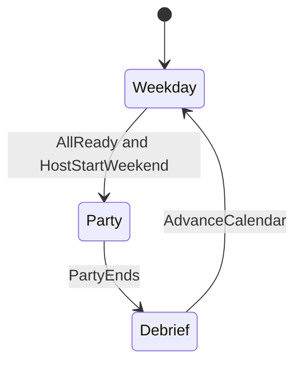

# Campus Social Loop

## Decisions locked in

- **Scene:** Reuse [`Game.unity`](Assets/Scenes/Game.unity) — party house and shop are already on campus; weekday = roam that map.
- **Multiplayer:** Shared campus; players roam together (shop, chores, meet NPCs) during weekday downtime.
- **Cast:** ~15 named progression NPCs + anonymous filler guests at parties (named need not all attend).
- **Dialogue:** [Yarn Spinner](https://yarnspinner.dev/) now (not Ink; not a custom tree unless Yarn fails integration).
- **Time:** Real-time weekday clock, same pattern as party duration / in-game time ([`NetworkedParty.GetCurrentInGameTime`](Assets/Scripts/Networking/NetworkedParty.cs)).
- **Start weekend:** Each player taps **Ready for Weekend** on the phone; when all are ready, **host** can **Start Weekend**.
- **Named NPC net:** Server-authoritative schedules/positions — everyone sees the same Brad at the gym.
- **Recruit:** Success increments [`FraternityData.memberCount`](Assets/Scripts/Gameplay/Fraternity.cs); assign jobs (security, cleaning, DJ) later.
- **Meet loop:** Short Yarn talk → unlock contact, or reject if frat popularity/grade too low vs NPC rarity.
- **Affinity:** Drives invite/RSVP odds and party behavior (e.g. low affinity → trouble offset even if not a base troublemaker).

Phone MVP remains the weekday hub (contacts, invites, ready/start). See [phone plan](phone_ui_system_10954784.plan.md).

---

## Session loop



| Phase | What happens |
|-------|----------------|
| **Weekday** | Shared roam; shop; chores; meet named NPCs (Yarn); phone invites; Ready for Weekend |
| **Party** | Party house active; named invites spawn first, then fillers; existing party clock 22:00→02:00 |
| **Debrief** | Bank cash/popularity/trouble; clear invites; optional short UI; advance day → Weekday |

---

## Weekday clock (mirror party time)

Party already uses:
- Real duration minutes → server `_partyStartTime` / `_partyEndTime` via `NetworkManager.ServerTime`
- Presentation time: `inGameTimeStart` + elapsed scaled to in-game hours (`GetCurrentInGameTime`: ~4 in-game hours per real minute)

Weekday should reuse that pattern on a networked calendar component:

| Field | Role |
|-------|------|
| `GamePhase` NetworkVariable | Weekday / Party / Debrief |
| `DayOfWeek` (0–6) + week index | Schedule key for named NPCs |
| `WeekdayStartServerTime` | Anchor like party start |
| `WeekdayDurationMinutes` | Real minutes for a full weekday (tunable) |
| `InGameTime` | Derived float hours 0–24 from elapsed × scale |

Schedule lookups use **day-of-week + current in-game hour** (or coarse slots Morning/Afternoon/Evening/Night derived from hour).

When phase → Party, freeze or ignore weekday clock; party uses existing party clock. On Debrief → Weekday, bump day and restart weekday clock.

---

## Campus locations

No new scene. Add a location registry in `Game`:

```text
CampusLocation
  id (string or Guid)
  displayName
  spawnPoint (Transform)
```

Seed locations that already exist in spirit: Party House, Shop, plus a few roam spots (Quad, Gym, Library, Dorm — placeholders OK).

Named NPC schedule entries reference `locationId` → server moves/spawns NPC NetworkObject at that transform.

---

## Named NPC data (Stardew-style)

```text
NamedNpcSO
  id
  displayName
  guestClass              // archetype DNA for filler-like stats
  contact                 // ContactSO link
  rarity                  // Common / Rare / Legendary (unlock bar)
  unlockMinPopularity
  unlockMinGrade          // optional
  baseTrouble / popularity / cash
  isRecruitable
  schedule[] : ScheduleEntry

ScheduleEntry
  dayOfWeek               // or mask
  startHour, endHour      // in-game hours
  locationId
```

Runtime (~15 networked actors):
- Server: on clock tick / hour change, resolve schedule → set position (or despawn if off-map).
- Clients: see replicated transform / active state only (no local schedule divergence).

`ContactSO` stays phone-facing; named NPC is the world identity. Prefer linking by id rather than only `GuestClass`.

---

## Yarn Spinner integration

**Install:** Yarn Spinner for Unity (OSS / package). Presenter should fit UI Toolkit (match shop/phone), not force uGUI if avoidable — thin adapter: Yarn line → UI Toolkit bubble.

**MVP node patterns per named NPC:**
- Meet / intro
- Reject branch (`<<if frat_popularity < threshold>>`)
- Unlock success (`<<unlock_contact npc_id>>` custom command)
- Later: recruit node (`<<recruit npc_id>>`)

**Networking:** Dialogue UI is **local** (like phone navigation). Only **outcomes** that change shared state go server: unlock contact, affinity delta, recruit, ready flag. If two players talk to the same NPC, server validates unlocks (idempotent unlock).

**Look lock:** Same as shop/phone while dialogue is open.

---

## Interact → unlock / reject

1. `FR_FirstPersonCharacter` raycast → named NPC `IInteractable`
2. Start Yarn dialogue for that NPC
3. Gate (in Yarn condition and/or C# before unlock command):

```text
canUnlock =
  frat.popularity >= npc.unlockMinPopularity
  && frat.grade <= npc.unlockMinGrade   // Grade enum: A best
  && optional roll vs rarity
```

4. Success → mark `ContactRuntimeState.unlocked`, affinity bump, optional notify others  
5. Fail → reject lines only; optional cooldown NetworkVariable per NPC per player or shared

Legendary NPCs = high bars + low roll → trophy unlocks.

---

## Weekend ready-up (phone)

| Step | Who | Net |
|------|-----|-----|
| Ready for Weekend | Each client | ServerRpc sets `ready[clientId]=true`; replicate ready count / bitmask |
| Unready | Optional | Clear own bit |
| Start Weekend | Host only, and only if all connected players ready | ServerRpc → `GamePhase=Party` → existing `StartParty` flow |

UI: phone app or home row showing ready dots + host-only Start button enabled when `allReady`.

---

## Party spawn + affinity

**Order**
1. Consume pending named invites (`NetworkedPhoneInvites` — wire into [`SpawnGuests`](Assets/Scripts/Networking/NetworkedPartyManager.cs))
2. For each invited named NPC: RSVP roll from affinity (+ outreach)
3. Spawn as **named** guest (sync contact/npc id, not only `GuestClass`)
4. Fill remaining slots with anonymous archetype rolls (current system)

**Affinity at party**

```text
effectiveTrouble = baseTrouble + AffinityTroubleOffset(affinity)
// low affinity → positive trouble even if archetype is mild
effectivePopularity contribution similarly softened/boosted
```

---

## Outreach (tunable formula)

ScriptableObject weights; draft:

```text
outreachScore =
    wPop  * Normalize(frat.popularity)
  + wGrade * GradeWeight(frat.grade)     // A high … F low
  + wAff  * AvgAffinity(unlocked)
  + wInv  * InvitesSentThisWeek
  + wMeet * NamedUnlocksThisWeek         // optional
```

Use `outreachScore` to bias named show-up and light filler arrival. Expose on HUD / phone later.

---

## Recruit (v1)

- Separate from unlock (needs higher affinity and/or Yarn recruit option).
- Server: validate → `memberCount++`, mark NPC recruited (can't double-recruit).
- Jobs (security, cleaning, DJ) = follow-on; data flag `RecruitRole` stub OK.

---

## Networking summary

| Concern | Authority |
|---------|-----------|
| Phase, calendar, weekday clock | Server |
| Named NPC position/schedule | Server |
| Ready bits / Start Weekend | Server (host gate on start) |
| Unlock / recruit / affinity that affects party | Server |
| Yarn UI, phone browsing | Local |
| Invite send (gameplay) | ServerRpc (existing phone invite path) |

---

## Implementation order

1. Yarn package + UI Toolkit line presenter + one stub NPC dialogue.
2. `NetworkedCampusCalendar` / `GamePhase` + weekday clock (reuse ServerTime pattern).
3. `CampusLocation` markers in Game scene.
4. `NamedNpcSO` + schedule data for a few NPCs (expand to 15).
5. Server schedule driver + networked named NPC prefab.
6. Interact → Yarn → unlock/reject commands.
7. Phone Ready + host Start Weekend → party phase.
8. Invite → named spawn + filler fill; affinity trouble offset.
9. Outreach SO + bias; recruit → memberCount.
10. Persistence for unlocks/affinity/day/roster.

## Out of scope (for first campus PR)

- Separate campus scene / open-world scale
- Ink or full narrative campaign
- NPC job simulation (security/DJ behavior)
- Free-text chat, calls, gallery
- Making all 15 attend every party
