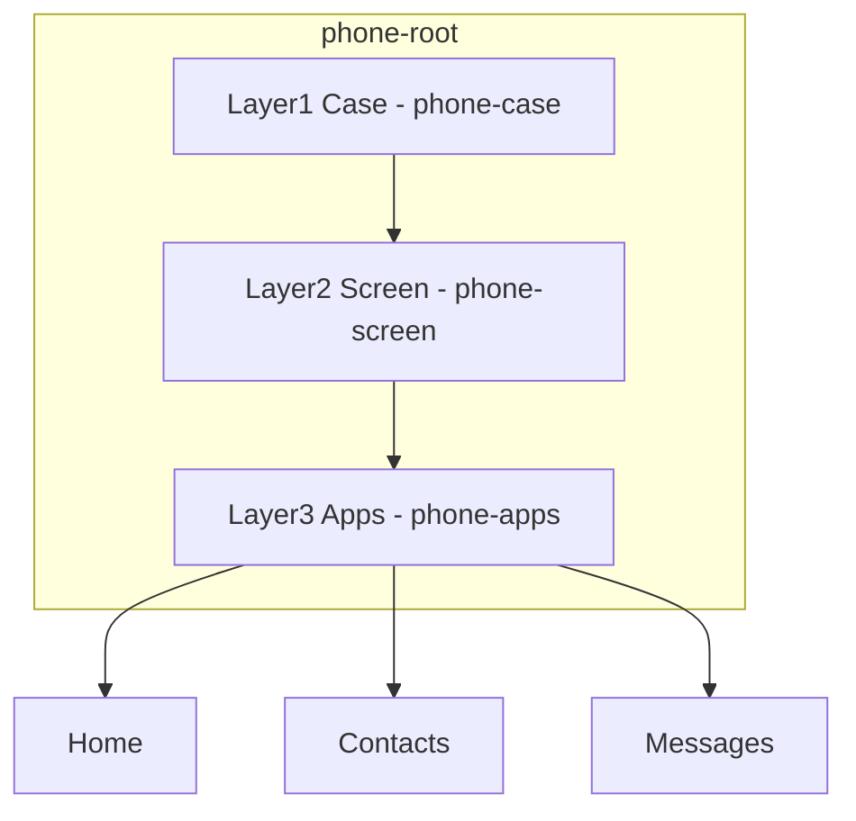
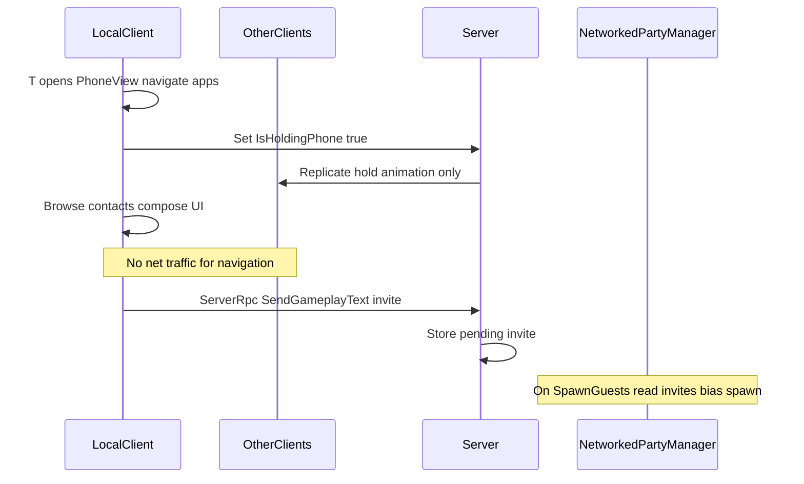

# Phone System — Custom UI Toolkit Plan

## Decisions locked in

- **Build in-house** with UI Toolkit (matches shop/inventory). No Asset Store phone kit.
- **Art:** flat rect textures / USS `background-image` placeholders — swap later without restructuring UXML.
- **Layers (bottom → top):** Case → Screen → Apps.
- **MVP apps only:** Home, Contacts, Messages.
- **Networking philosophy (thin):** phone UI is almost entirely local. Replicate only (1) **phone-hold pose/animation** when the phone is open, and (2) **actions that change game state** (e.g. sending an invite text). Navigating apps, scrolling contacts, reading threads — never networked.
- **Invite effect:** when a canned text has a gameplay flag, ServerRpc stores pending invite that biases [`NetworkedPartyManager.SpawnGuests`](Assets/Scripts/Networking/NetworkedPartyManager.cs) via [`GuestSO.GetModifiedArrivalChance`](Assets/Scripts/Gameplay/ScriptableObjects/Guest/GuestSO.cs).

## Visual layering



UXML skeleton (concept):

```xml
<ui:VisualElement name="phone-root" class="phone-root" style="display: none;">
  <ui:VisualElement name="phone-case" class="phone-case" />      <!-- case texture -->
  <ui:VisualElement name="phone-screen" class="phone-screen">  <!-- screen bezel / wallpaper -->
    <ui:VisualElement name="phone-apps" class="phone-apps">    <!-- app content host -->
      <!-- Home / Contacts / Messages swapped here -->
    </ui:VisualElement>
  </ui:VisualElement>
</ui:VisualElement>
```

- Case = outer chrome (rounded rect texture).
- Screen = inset overlay (status bar + wallpaper texture); clips apps.
- Apps = content only; no case chrome inside app UXML so case/screen art can change independently.

Follow shop pattern: root starts `display: none`, toggle like inventory/shop ([`Shop.uxml`](Assets/Scripts/UI/Shop/UI/Shop.uxml), [`ShopView.cs`](Assets/Scripts/UI/Shop/ShopView.cs)).

---

## MVP (ship this first)

### UI

| Piece | Role |
|-------|------|
| `Phone.uxml` + `Phone.uss` | Layered shell + status bar + home grid |
| `PhoneView.cs` | Bind `UIDocument`, open/close, navigate apps, cursor/look lock like shop |
| Home | 2 icons: Contacts, Messages (+ Close / power affordance) |
| Contacts | Scroll list of unlocked contacts (name, archetype tag, avatar rect) |
| Messages | Thread list → thread view; compose from **canned templates** only (no free-text MVP) |

Placeholder textures under something like `Assets/UI/Phone/Placeholders/` (white/gray rects). USS classes: `.phone-case`, `.phone-screen`, `.app-icon`, `.contact-row`, `.msg-bubble-out`, `.msg-bubble-in`.

### Data

| Type | Purpose |
|------|---------|
| `ContactSO` | Named person: id, display name, gender/tag, avatar sprite, linked `GuestClass` (or `GuestSO`), starting unlocked |
| `ContactRuntimeState` | Unlocked, affinity (0 for MVP), last invite / RSVP |
| `MessageTemplateSO` | Short canned texts: Invite / HangOut / Weird — each with affinity delta + invite flag |
| `PhoneContactDatabase` | Resources load of contacts (same pattern as [`ItemDatabase`](Assets/Scripts/UI/InventorySystem/Inventory/ItemDatabase.cs)) |

Seed ~6–10 contacts mapped onto existing guest archetypes (Nerd / MeanGirl / Jock / None) so invites map cleanly to spawn weights.

### Networking split

| What | Local or net | Notes |
|------|--------------|-------|
| Press T / open phone UI | Local UI + **replicated hold** | Local: show `PhoneView`, look lock. Net: `IsHoldingPhone` (or animator bool) so other clients see the hold animation |
| Navigate Home / Contacts / Messages | **Local only** | No RPCs, no NetworkVariables |
| Scroll, open thread, browse templates | **Local only** | |
| Message history / draft UI | **Local only** | In-memory or local save |
| Send template with gameplay effect (Invite) | **ServerRpc → shared state** | Server stores pending invite; chat bubbles do not need replication |
| Flavor-only template (no gameplay impact) | **Local only** | Skip net until the action actually changes game state |



- No full phone state sync. Do not replicate which app is open or message history.
- Hold animation = cosmetic sync. Pending invites = only MVP gameplay sync.

### Input / integration

- Add `Phone` action (e.g. T) to [`StarterAssets.inputactions`](Assets/StarterAssets/InputSystem/StarterAssets.inputactions) Player map.
- Wire toggle from [`FR_FirstPersonCharacter`](Assets/Scripts/Gameplay/FR_FirstPersonCharacter.cs) beside inventory.
- On open: local UI + look/move mute + set replicated hold flag/anim.
- On close: hide UI + clear hold flag.

### Folder layout

```
Assets/Scripts/UI/Phone/
  PhoneView.cs
  PhoneController.cs
  ContactSO.cs
  MessageTemplateSO.cs
  PhoneContactDatabase.cs
  UI/Phone.uxml
  UI/Phone.uss
Assets/UI/Phone/Placeholders/   # rect textures
```

---

## v2 — Relationships + richer texts

- Affinity score per contact; templates and replies change with affinity tiers.
- Incoming NPC replies (timed / on party end) with canned response trees — local UI; only net if affinity/RSVP changes shared party state.
- Group / “party list” — multi-select contacts for mass invite (gameplay effect → server).
- Unlock rules: talk stub on [`NPCGuest.Interact`](Assets/Scripts/Gameplay/NPCGuest.cs), party attendance, recruitable flag.
- Persist phone state via existing [`Systems.Persistence`](Assets/Scripts/UI/InventorySystem/Persistence/) patterns (local/player save, not NGO).
- Optional: Calls app stub (flavor only) or Notifications banner on HUD.
- Named contacts can appear at parties as identifiable guests (not only class roll).

## v3 — Campus social loop

- Simple weekday beat between parties (even menu-driven at first: Weekday → Phone → Start Weekend).
- Small campus scene(s): roam, meet NPCs, unlock numbers face-to-face.
- Schedules / location tables for a handful of “real” NPCs (not every guest).
- Deeper relationship axes if needed (friendship vs chaos/trouble contribution).
- Outreach quality becomes a primary lever for weekend party composition and frat metrics.

---

## Implementation order (MVP only when executing)

1. UXML/USS layered shell + placeholder textures + open/close.
2. Home → Contacts / Messages navigation (no net yet).
3. `ContactSO` + seed data + Contacts list bind.
4. Message templates + local thread UI.
5. ServerRpc only for gameplay-effecting sends → `SpawnGuests` bias.
6. Input (T) + local UI toggle + replicated hold animation + playtest.

## Out of MVP scope

Campus, free-text chat, camera/gallery, real calls, Asset Store phone kits, full dialogue system, replicating phone navigation/UI state.
