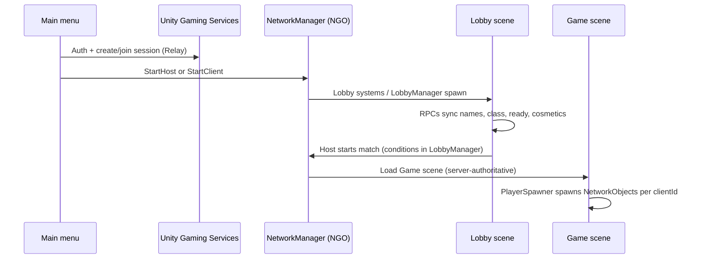

# FratRow

**FratRow** is a **multiplayer, networked Unity game**. This repository is structured as a portfolio showcase for **network gameplay engineering**: session discovery, authoritative simulation, replicated entities, and a full **lobby → gameplay** pipeline.

Built with **Unity 6** (`6000.3.x`) and **[Netcode for GameObjects](https://docs-multiplayer.unity3d.com/netcode/current/about/)** (NGO).

---

## Networking at a glance

| Layer | Role in this project |
|--------|----------------------|
| **Unity Gaming Services** | Anonymous authentication so each client has a stable player identity for sessions. |
| **Unity Multiplayer Sessions** | Create/join sessions by **session code**, player join/leave events, host detection. Sessions are created with **Relay**, so peers connect without manual port forwarding (NAT traversal). |
| **Unity Relay** | Transport path for hosts and clients behind routers; wired through session options (`.WithRelayNetwork()`). |
| **Netcode for GameObjects** | Host/client model (`NetworkManager`), spawned `NetworkObject`s, **`NetworkVariable`** state, **`[Rpc]`** messaging, **`NetworkBehaviour`** gameplay logic. |

Together, **Sessions + Relay** handle “who can join which game,” while **NGO** handles **what happens inside** the session (lobby sync, spawning, gameplay state).

---

## Architecture: sessions vs. game netcode

1. **Out-of-game / matchmaking:** `NetworkBootstrap` initializes Unity Services (`InitializeServicesAsync`), then **`SessionManager`** creates or joins a **`MultiplayerService`** session (`CreateSessionAsync` / `JoinSessionAsync`). The active session exposes a shareable **code** and Relay-backed connectivity metadata.

2. **In-game:** **`NetworkManager`** starts as **host** or **client** (`StartHost` / `StartClient`). Server-authoritative NGO rules apply: the server owns spawn decisions and authoritative updates; clients run prediction/interpolation where configured and receive replicated state.

3. **Scene flow:** Main menu kicks off session + NGO start → **Lobby** scene for readiness and cosmetics → **`NetworkManager.SceneManager`** loads the **Game** scene when the lobby agrees to start (host-driven).

---

## Entities: how networked objects work

Gameplay uses the standard NGO split: **`NetworkObject`** identity + **`NetworkBehaviour`** scripts + replicated fields and RPCs.

### Players

- Characters are spawned on the **server** as **`NetworkObject`** instances, typically **`SpawnAsPlayerObject(clientId)`** so each client owns their **`LocalClient.PlayerObject`** (`PlayerSpawner`).
- **`NetworkedUserCharacter`** attaches to the player prefab and syncs **`NetworkVariable`s** (e.g. class, popularity, trouble, cash) while **`UserCharacter`** holds local/gameplay-facing behavior.
- Class data comes from **`NetworkedGameManager`** scriptable lookups (`PlayerClassSO`), initialized after spawn when the server applies lobby choices.

### Lobby vs. session identity

- **Lobby roster** is keyed by NGO **`ulong` client IDs** (`LobbyManager`), not just UGS strings—bridging transport identity to in-game replication.
- **`LobbyRPCs`** exposes **ServerRpc** / **ClientRpc** patterns for name, class, ready toggles, visual indices, and **snapshot requests** so late-joining clients can request full lobby state from the server.

### Shared / world state

- **`NetworkedGameManager`** is a **`NetworkBehaviour`** that aggregates **faction-level `NetworkVariable`s** (totals for popularity, cash, trouble, fraternity data)—useful as a single place for **server-authoritative** scores and subscribers on clients.

### NPCs / guests

- Party guests and related flows use additional **`NetworkBehaviour`** types (e.g. networked party managers, guest prefabs spawned with **`NetworkObject.Instantiate`** on the server) so AI or interactable entities participate in the same replication model as players.

---

## Lobby workflow (end-to-end)

High-level sequence:

**Details implemented in code:**

- **Host:** after services init → **`SessionManager.CreateSessionAsync`** → **`NetworkBootstrap.StartHost`** → load **Lobby**.
- **Client:** join by **session code** → **`JoinSessionByCodeAsync`** → **`StartClient`** → once **`LobbyManager`** / lobby systems exist on the network, clients synchronize via **`LobbyRPCs`** (including **`RequestLobbyStateRPC`** style recovery for ordering/race cases).
- **Lobby UI** reads **`LobbyManager`**’s replicated roster and fires RPCs for local actions; the **server** remains authoritative for who is ready and when **`LoadScene`** runs for **`Game`**.

---

## Repo map (networking-centric)

| Area | Purpose |
|------|---------|
| `Assets/Scripts/Networking/` | Bootstrap, sessions, lobby manager/RPCs, party manager, player spawn, connection helpers. |
| `Assets/Scripts/UI/` | Main menu session create/join, lobby UI wired to **`NetworkManager`** and **`LobbyManager`**. |
| `Assets/Scripts/Gameplay/` | Game rules that intersect with **`NetworkBehaviour`** / server checks (e.g. fraternity, party spawning). |

---

## Running & configuration

1. Open the project in **Unity 6** (`6000.3.x` recommended to match `ProjectSettings/ProjectVersion.txt`).
2. Configure **Unity Gaming Services** for your organization (multiplayer sessions + Relay). Anonymous sign-in used in **`NetworkBootstrap`** assumes a linked UGS project—link credentials in the Unity dashboard and Editor as usual; **secrets are not committed** to this repo.
3. Assign **network prefabs** (player, lobby systems, etc.) per NGO project settings and scene setup.

Local multi-instance workflows can use tooling such as **ParrelSync** clones; this codebase signs clone clients as distinct anonymous players so they do not collide with the host identity.

---

